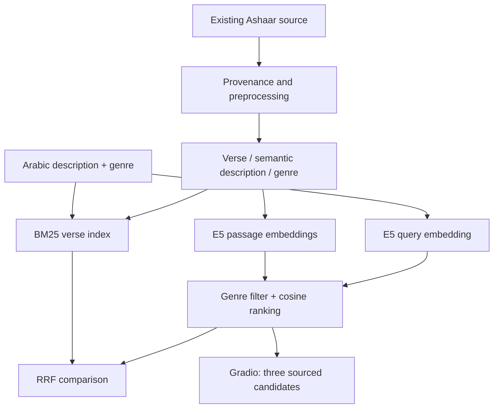

# Arabic Poetry Semantic Retrieval

### مشروع الاسترجاع الدلالي للشعر العربي

An Arabic NLP application that retrieves contextually relevant poetic verses from a description and poetic genre using pretrained multilingual E5 embeddings, BM25 and hybrid retrieval.

**Release status:** code-only preparation. The 3,000-record corpus and embedding indexes require separate authorized access. Public live deployment is blocked by unresolved data rights and account access. No live demo URL is claimed.

## Application Demo

The real application uses a brown, cream and white Arabic literary interface. Screenshot capture is pending because the computer/browser capture host was unavailable during preparation. Poetry-bearing screenshots also require reuse clearance before publication. No generated or simulated results are used.

## Project Overview

Traditional keyword search can miss relevant Arabic poetry when a person's description and a poetic verse express the same idea with different words. This project compares semantic embeddings from multilingual E5 with BM25 and combines rankings through Reciprocal Rank Fusion (RRF).

The current interface displays the top three **E5-description** candidates. BM25 over verses, E5 over verses and RRF are implemented comparison methods available through the Python engine. Hybrid retrieval is not the default interface ranking. The system retrieves existing poetry; it does not generate new verses.

## Features

- Arabic biography/description input and an Arabic Gradio interface.
- Six genres: مدح، هجاء، غزل، فخر، رثاء، عتاب.
- Existing local corpus of 3,000 poetry–description records, balanced at 500 per genre.
- Transformer-based semantic embeddings and exact cosine retrieval.
- BM25 lexical retrieval and hybrid BM25 + E5 ranking through RRF.
- Three distinct candidate bayts with supplied poet attribution, source references and uncalibrated similarity scores.
- Input validation and a limited living-person/elegy consistency check.

## Dataset

The source is [Ashaar on Hugging Face](https://huggingface.co/datasets/arbml/ashaar). A historical audit inspected **254,630 poems** in two local Parquet shards. The existing selected corpus contains **3,000 poetry–description pairs**, 590 recorded poet strings and 2,998 poem families.

The records preserve original poem/source references and distinguish verse text from its semantic description. These descriptions are **not independently sourced historical biographies**: 2,990 originated from automated lexical templates and ten from an individually approved pilot. Bulk semantic approval does not establish independent literary review, source authenticity or reuse permission. Bayt segmentation is heuristic and every poem has not been independently verified.

The frozen integrated split ledger has 2,400/300/300 records with 400/50/50 per genre and links known poet, poem, normalized verse and shared-half families. The supplied manifest has older split estimates; the integrated ledger supersedes those estimates. Template reuse, uncertain aliases and pretraining overlap limit generalization claims. Retrieval demonstrations search the complete existing corpus and are not final-test evaluation.

**The corpus, split files and derived embeddings are not included in Git.** See [data access](data/README.md) and [index specification](indexes/README.md). Upstream availability alone does not clear redistribution or training rights.

## Methodology

1. **Collection:** inspect the existing Ashaar source files and preserve provenance.
2. **Preprocessing:** retain original verse text; strip diacritics/tatweel and normalize tokens for lexical comparison and duplicate suppression. No stemming or semantic negation removal is introduced.
3. **Pairing:** associate supplied two-hemistich verses with genre and automatically proposed descriptions; preserve annotation limitations.
4. **Embedding:** use pretrained [`intfloat/multilingual-e5-small`](https://huggingface.co/intfloat/multilingual-e5-small), revision `614241f622f53c4eeff9890bdc4f31cfecc418b3`. Documents use `passage: `; user descriptions use `query: `. Masked mean pooling and L2 normalization yield 384-dimensional vectors. Inputs above 512 tokens are rejected rather than silently truncated.
5. **BM25:** index verse tokens with k1=1.2 and b=0.75. A description-only BM25 baseline is also preserved in the historical evaluation.
6. **Cosine similarity:** rank normalized description/verse embeddings through NumPy dot products within the selected genre.
7. **RRF:** combine the top 100 BM25-verse and E5-description rankings using `1 / (60 + rank)` with one-based ranks. Deduplicate normalized full verses in the displayed top three.
8. **Application:** present E5-description candidates in Gradio with attribution, source and score. The Python `FinalEngine.rankings()` exposes comparisons.
9. **Evaluation:** reproduce saved provisional pooled metrics; distinguish this from independent retrieval evaluation.



## Evaluation

These are **saved measurements**, not new benchmark results. The diagnostic deepened only **three answerable AI-authored, AI-judged development queries**, with 108 original and 84 supplementary judgments across the wider diagnostic. The three-query pool has full top-ten judgment coverage for five methods. Relevance is grade ≥3 on a 0–4 rubric. Recall uses known positives in the incomplete judged pool, not all relevant verses in the corpus.

| Method | Hit@1 | Pooled Recall@10 | MRR@10 | nDCG@10 |
|---|---:|---:|---:|---:|
| bm25_verse | 0.3333 | 0.1508 | 0.3667 | 0.2787 |
| e5_verse | 0.0000 | 0.5992 | 0.3889 | 0.5068 |
| bm25_description | 0.0000 | 0.0714 | 0.0667 | 0.1947 |
| e5_description | 0.6667 | 0.2381 | 0.6667 | 0.3557 |
| hybrid | 0.3333 | 0.2897 | 0.5833 | 0.3509 |

The query author and relevance judge were AI; this is not independent human assessment or held-out generalization. Selecting E5-description for the interface used this small diagnostic. Different text views also confound algorithm comparisons. No state-of-the-art, calibrated accuracy or E5 fine-tuning improvement is claimed.

```bash
python -m src.evaluation
python -m unittest discover -s tests -v
```

The release includes saved rankings and text-free ID/grade judgments to reproduce those aggregate measurements. Historical judgments and full evidence remain in the preserved local project.

## Installation

Python 3.10–3.12; Python 3.12 and the pinned packages were used on the original Windows machine. Use a source checkout because the app loads CSS/JS relative to `app.py`.

Repository creation is pending authenticated GitHub access. The verified clone URL will be inserted after creation; no unverified repository URL is presented as working.

```bash
cd arabic-poetry-semantic-retrieval
pip install -r requirements.txt
```

Provide the authorized external artifact bundle described in [data/README.md](data/README.md). Also provide a local snapshot of the exact pretrained E5 revision. Model weights are excluded and the app never downloads them automatically. Hugging Face's `hf download intfloat/multilingual-e5-small --revision 614241f622f53c4eeff9890bdc4f31cfecc418b3` can obtain a snapshot separately where permitted; set the path to its returned snapshot directory.

PowerShell:

```powershell
$env:ARABIC_POETRY_ARTIFACTS = "C:\path\to\authorized-bundle"
$env:ARABIC_POETRY_E5_PATH = "C:\path\to\e5-snapshot"
python app.py
```

Linux/macOS:

```bash
export ARABIC_POETRY_ARTIFACTS=/path/to/authorized-bundle
export ARABIC_POETRY_E5_PATH=/path/to/e5-snapshot
python app.py
```

Open the local URL printed by Gradio (default port 7860). This is a local development address, not a public demo. Public Gradio sharing is disabled. CPU inference is sufficient; CUDA is not required. Notebook exploration additionally needs Jupyter/IPython. The [existing notebook](notebooks/Arabic_Poetry_Retrieval.ipynb) has cleared outputs and requires the same external bundle.

## Repository Structure

```text
app.py                 Arabic Gradio interface
src/embedding.py       Pinned local E5 inference and pooling
src/lexical.py         Arabic normalization and BM25
src/engine.py          Cosine, genre filtering and RRF
src/rendering.py       Escaped candidate/source markup
src/evaluation.py      Saved pooled metric reproduction
src/content.py         Arabic page content and corpus showcase
src/core.py            Request validation and response handling
assets/                Original CSS and optional motion
data/README.md         External data contract and rights status
indexes/README.md      Existing index specification
evaluation/            Saved text-free diagnostic evidence
notebooks/             Adapted existing retrieval notebook
tests/                 Offline unit tests
deployment/            Spaces configuration and blockers
```

## Technologies

| Technology | Role |
|---|---|
| Python | Application and retrieval orchestration |
| PyTorch | Pretrained encoder inference |
| Hugging Face Transformers | E5 tokenizer and model loading |
| Multilingual E5-small | 384-dimensional semantic representations |
| BM25 | In-project lexical ranking implementation |
| NumPy / cosine similarity | Exact vector search over normalized matrices |
| RRF | Rank-based lexical/dense fusion |
| Gradio | Arabic responsive web interface and API |
| Pandas | Notebook inspection and metric tables |

## Limitations and Future Work

- Stronger independent retrieval evaluation is needed, with diverse queries and genuine human judgments.
- Source attribution, segmentation, genre labels and automatic descriptions are incompletely verified; source rights remain unresolved.
- Scores are ranking signals, not probabilities. No-match thresholds require calibration; unsupported queries may still return unsuitable candidates.
- BM25 and dense methods currently use different text views in some comparisons. Match views for stronger controlled comparisons.
- Consider future domain-specific E5 fine-tuning only after approved data and a controlled evaluation design. **Poetry-specific E5 fine-tuning has not been completed.**
- Public Spaces deployment requires cleared corpus/index access, account authentication and confirmation of hosting availability. See [deployment notes](deployment/README.md); no live URL is available.

## Release and Attribution

This repository adapts the existing Plan B retrieval application and preserves previous local experiments. It excludes the unrelated Fanar-Diwan generation project. No source-data or pretrained-model ownership is claimed. No software license has been assigned on the owner's behalf. Consult upstream terms and resolve rights before redistribution.
